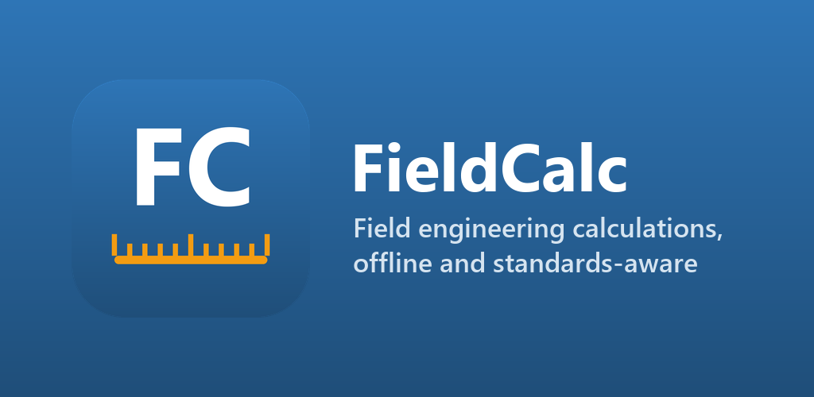
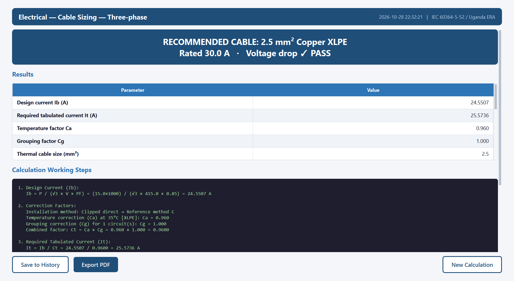
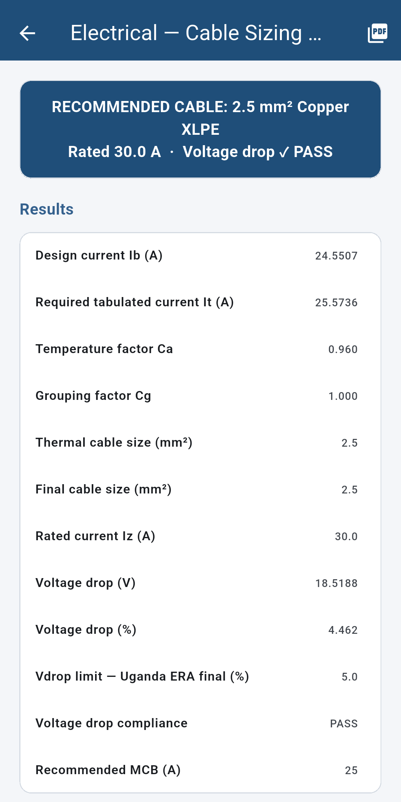

# FieldCalc

**Field engineering calculations — offline, step by step, with PDF reports.**
By Arapai Technologies International · Advancing Innovation

**Website:** https://josephwalusimbi-eng.github.io/FieldCalc-Releases/

FieldCalc covers electrical, electronics, civil and mechanical engineering, with a nuclear module for estimation and awareness only. Every result shows its formula and working, and can be exported as a PDF calculation sheet. It needs no internet connection, account or ads.

## Download

Get the latest version from the **[Releases page](../../releases/latest)**.

| Platform | File | Notes |
|----------|------|-------|
| Android 7.0+ | `FieldCalc-<version>.apk` | See *Installing on Android* below |
| Windows 10/11 (64-bit) | `FieldCalc-<version>-windows-x64.zip` | Unzip and run `FieldCalc.exe` |

On Windows, FieldCalc is also in the **[Microsoft Store](https://apps.microsoft.com/detail/9PFVRN728498)**, where it updates automatically. Google Play is coming. FieldCalc is available in English and French.

### Installing on Android
1. Download the `.apk` file on your phone.
2. Open it. If Android asks, allow your browser or file manager to **install unknown apps**.
3. Tap **Install**.

To check the download, compare its SHA-256 with the value listed in the release notes.

### Installing on Windows
1. Download and unzip the `.zip` file to a folder, for example `C:\FieldCalc`.
2. Run `FieldCalc.exe`.
3. If Windows SmartScreen shows "Windows protected your PC", choose **More info → Run anyway**. This appears because the download is not code-signed. The Microsoft Store version does not show it.

Calculation history is stored in `%APPDATA%\FieldCalc`.

## Screenshots

| Windows | Android |
|---------|---------|
|  |  |

## What's included

- **Electrical:** cable sizing and voltage drop (IEC 60364-5-52, BS 7671), load schedules, solar PV, battery banks, transformers, power factor correction, short-circuit current, earthing (BS 7430 rods, BS 7671 fault loop), standby generator sizing
- **Electronics:** resistor networks and dividers, RC/RL/LC filters, op-amp circuits, power supplies, PCB trace width (IPC-2221), battery runtime
- **Civil:** concrete volumes and materials, beam deflection, column load (BS 8110 / BS 5950), pipe flow and drainage, soil bearing and settlement, bar bending schedules, masonry and plaster quantities
- **Mechanical:** pump sizing, motor selection, shaft power, heat load, belt and pulley
- **Water & Sanitation:** water demand, storage and rainwater tanks, solar borehole pumps, septic tanks (BS 6297) and soak pits
- **AI & ML:** LLM memory and speed, model evaluation metrics, Edge AI estimators, solar power for AI devices
- **Nuclear (estimation only):** dose rate, shielding thickness, isotope decay
- **Tools:** scientific calculator on every screen, projects and history with whole-project PDF reports, field measurement from a photo, light and dark themes

Every calculation is checked by an automated test suite against independently worked reference examples.

> FieldCalc is a calculation aid. Have results checked by a qualified engineer before using them in design, construction or safety decisions. The nuclear module is not certified software.

## Privacy

FieldCalc collects no data. See the [privacy policy](PRIVACY_POLICY.md).

## Support

Email **arapaigroup@gmail.com**, or open an issue on this repository.

---
© 2026 Arapai Technologies International. All rights reserved.
